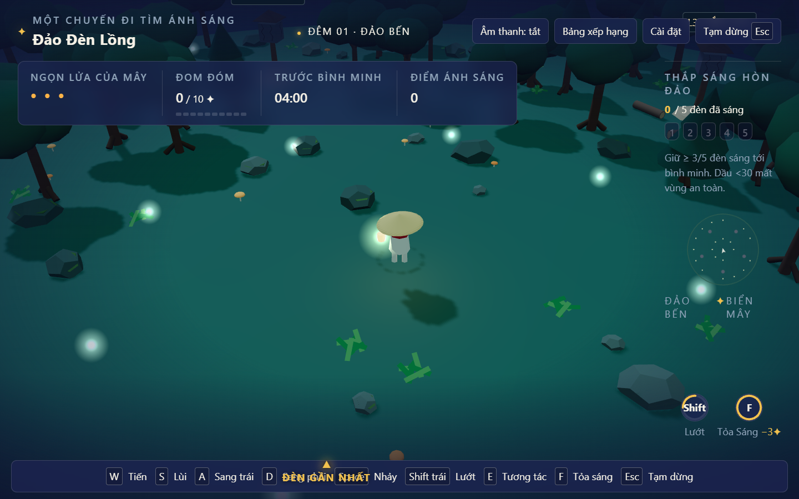

# Đảo Đèn Lồng · v1.0.0 — Bình minh

**Video demo:** sẽ bổ sung video MP4 dưới 5 phút trước khi nộp. [Tải bản chơi v1.0.0](https://github.com/SonLNH19/K5-L3A-DAY12-LeNguyenHoangSon-2A202603686-AI-SDLC-Dao-Den-Long/releases/tag/v1.0.0).



Game 3D góc nhìn thứ ba: cùng Mây gom đom đóm, thắp sáng các Đèn Lồng Lớn và né Bóng Mực, Gió Lạc qua 3 hòn đảo (Đảo Bến, Đảo Cau, Đảo Chuông). Nhân vật, bối cảnh và đề bài là bản gốc của lab Day 12 AI SDLC.

**Phạm vi hiện tại:** Ticket-04, Test Contract v1.3. Giữ luật Phase 3: sống tới bình minh, ít nhất 60% đèn sáng. Thêm benchmark, soak, bảng điểm lưu trên đĩa, đổi phím và khả năng tiếp cận. [Bằng chứng Phase 4](docs/proof/phase-4/) · [Changelog 4 phase](CHANGELOG.md) · [Retro](docs/notes/RETRO.md).

## Cài và chơi trong 3 lệnh

Cần Node.js 24 LTS hoặc mới hơn, npm và trình duyệt hỗ trợ WebGL. Cài thư viện lần đầu cần mạng; khi chơi không tải CDN hay asset bên ngoài.

```bash
npm ci
npm run build
npm start
```

Mở **http://localhost:4173**. Trên Windows PowerShell, dùng `npm.cmd` thay `npm` nếu bị chặn script.

## Hướng dẫn chạy trên Windows

### Chuẩn bị

1. Cài **Node.js từ phiên bản 24 trở lên**, kèm npm. Trong bộ cài, giữ lựa chọn **npm package manager** và **Add to PATH**, rồi hoàn tất cài đặt.
2. Đóng và mở lại PowerShell; nếu dùng Terminal trong VS Code thì mở lại VS Code. Kiểm tra:

```powershell
node --version
npm.cmd --version
```

Node cần hiện `v24...` hoặc mới hơn. Dùng Chrome hoặc Edge hỗ trợ WebGL2, bật tăng tốc đồ họa.

### Chạy từ mã nguồn — 3 lệnh

Tải/clone repo và giải nén nếu cần. Mở thư mục **chứa `package.json`** trong File Explorer, gõ `powershell` vào thanh địa chỉ rồi nhấn Enter. Chạy lần lượt:

```powershell
npm.cmd ci
npm.cmd run build
npm.cmd start
```

Giữ cửa sổ PowerShell mở, vào **http://localhost:4173**, nhấn **Bắt đầu chuyến đi**. Những lần chơi sau chỉ cần `npm.cmd start`. Nhấn **Ctrl+C** trong PowerShell để dừng server. Không nhấp đúp `index.html` để chơi.

### Chạy gói ZIP phát hành — không cần cài thư viện

Tải **dao-den-long-v1.0.0.zip** ở [Release v1.0.0](https://github.com/SonLNH19/K5-L3A-DAY12-LeNguyenHoangSon-2A202603686-AI-SDLC-Dao-Den-Long/releases/tag/v1.0.0), chọn **Extract All / Giải nén tất cả**. Mở PowerShell trong thư mục chứa `run.mjs`, chạy:

```powershell
node run.mjs
```

Mở **http://localhost:4173**. Gói này vẫn cần Node.js ≥24 nhưng không cần `npm ci` hay build.

### Kiểm tra và xử lý lỗi trên Windows

Các lệnh sau chạy từ thư mục mã nguồn chứa `package.json`; bản ZIP chỉ dùng để chơi:

```powershell
npm.cmd run verify
npm.cmd run test:browser
node src/headless.mjs --seed 19 --night 1 --ticks 600 --out output.jsonl
npm.cmd run bench -- --seed 42 --duration 30 --out bench.json
npm.cmd run soak -- --seed 7 --nights 10 --out soak.json
```

Chạy lần lượt; khi benchmark, giữ cửa sổ ở trước và không chạy browser test cùng lúc.

| Hiện tượng | Cách xử lý |
|---|---|
| `node` hoặc `npm.cmd` không được nhận diện | Cài Node.js với Add to PATH, đóng/mở lại PowerShell hoặc VS Code, kiểm tra phiên bản |
| PowerShell báo `npm.ps1 cannot be loaded` | Dùng `npm.cmd` như hướng dẫn; không cần đổi Execution Policy |
| Không tìm thấy `package.json` | Chuyển vào đúng thư mục mã nguồn trước khi chạy npm |
| Cổng 4173 đang dùng | Dừng server cũ bằng Ctrl+C; hoặc chạy `$env:PORT='4174'; npm.cmd start` và mở http://localhost:4174. Với ZIP dùng `node run.mjs` thay `npm.cmd start` |
| Trang trắng hoặc lỗi WebGL | Bật tăng tốc đồ họa trong Chrome/Edge, cập nhật driver GPU và xem thông báo lỗi trên trang |
| Trang còn bản cũ | Dừng server, chạy lại rồi nhấn Ctrl+Shift+R trong trình duyệt |

## Hướng dẫn chạy trên macOS và Linux

### Chuẩn bị

- Cài **Node.js từ phiên bản 24 trở lên**, kèm npm, từ [trang tải Node.js chính thức](https://nodejs.org/en/download). Node.js 24 là phiên bản đã dùng để kiểm tra trên runner Linux/macOS.
- Chọn gói phù hợp máy: macOS Apple Silicon dùng ARM64, Mac Intel dùng x64; Linux chọn đúng kiến trúc máy.
- Dùng Chrome/Chromium hoặc trình duyệt hỗ trợ **WebGL2** để chơi giao diện 3D.
- Tải hoặc giải nén mã nguồn bản cần chạy, rồi mở **Terminal trong thư mục chứa `package.json`**. Trên macOS dùng Terminal; trên Linux dùng terminal của hệ điều hành.

Kiểm tra công cụ đã cài:

```bash
node --version
npm --version
```

Lệnh đầu cần hiện `v24...` hoặc mới hơn. Nếu báo không tìm thấy lệnh, cài Node.js rồi đóng/mở lại Terminal.

### Cài đặt và mở game — giống nhau trên cả hai hệ

Chạy trong thư mục dự án:

```bash
npm ci
npm run build
npm start
```

1. `npm ci` cài đúng phiên bản thư viện trong `package-lock.json`; cần Internet khi tải thư viện.
2. `npm run build` tạo bản web tĩnh trong `dist/`, gồm thư viện và asset cục bộ.
3. `npm start` mở server. Giữ Terminal chạy, mở trình duyệt tới **http://localhost:4173**, rồi nhấn **Bắt đầu chuyến đi**. `start` cũng tự build nên những lần sau có thể chỉ chạy `npm start`.

Dùng WASD, Space, E, F và Shift/J như bảng điều khiển bên dưới. Để dừng server, quay lại Terminal và nhấn **Ctrl+C**. Không mở `index.html` bằng cách nhấp đúp; game cần được phục vụ qua HTTP.

### Chạy headless hoặc tự kiểm tra

Mở Terminal thứ hai trong cùng thư mục nếu server vẫn đang chạy:

```bash
npm run verify
node src/headless.mjs --seed 19 --night 1 --ticks 600 --out output.jsonl
```

`verify` chạy test logic/CLI và build. Headless không tạo cửa sổ hoặc cần GPU; kết quả ghi vào `output.jsonl`. Có thể đổi `--night 1` thành `--night 2` hoặc `--night 3`.

### Xử lý nhanh

| Hiện tượng | Cách xử lý |
|---|---|
| `node` hoặc `npm` không tìm thấy | Cài Node.js >=24 kèm npm, mở lại Terminal và kiểm tra phiên bản |
| Lỗi thiếu thư viện/không có `node_modules` | Chạy lại `npm ci` trong thư mục có `package.json`, kiểm tra mạng |
| Cổng 4173 đang dùng | Dừng server cũ hoặc chạy `PORT=4174 npm start`, rồi mở http://localhost:4174 |
| Trang trắng/lỗi WebGL | Dùng Chrome/Chromium hỗ trợ WebGL2, bật tăng tốc đồ họa; xem thông báo lỗi trên trang |
| Vẫn thấy bản game cũ | Dừng server, chạy lại `npm start`, tải lại trang bằng Cmd+Shift+R trên Mac hoặc Ctrl+Shift+R trên Linux |

Đã kiểm tra thực tế cài đặt, build, headless và 71 test trên **Linux x64 và macOS 15 Intel x64** bằng GitHub Actions. Giao diện WebGL cũng đã có lượt kiểm tra trình duyệt thành công trên cả Linux và macOS. [Báo cáo, phạm vi và các giới hạn kiểm chứng](docs/notes/platform-verification.md).

## Điều khiển và luật chơi (Ticket-03)

| Phím | Hành động |
|---|---|
| WASD hoặc mũi tên | Di chuyển theo camera (6.0 m/s; 7.2 m/s khi có Bùa Gió) |
| Space | Nhảy (vận tốc 7.0 m/s, trọng lực -20 m/s²) |
| Shift / J | Lướt (14 m/s trong 0.2s, hồi chiêu 1.5s; lướt trên không giữ nguyên độ cao) |
| E | Nạp, thắp lại hoặc châm dầu cho đèn nhận được gần nhất (bán kính 2.0m) |
| F | Tỏa sáng (tốn 3 đom đóm, bán kính 5m, choáng 120 ticks, đẩy lùi 4m) |
| Q / R hoặc kéo chuột phải | Xoay camera |
| Esc / P | Tạm dừng trò chơi (menu Tiếp tục, Chơi lại, Cài đặt) |

### Luật chơi chính:
- **Đom đóm:** Sức chứa `min(20,10+2*successful_lights)`, reset mỗi Đêm. Nhặt tự động khi XZ <= 1.0m và chênh cao <= 1.5m.
- **Đèn lồng:** Thắp mới cần 10, thắp lại cần 5; nạp nhiều lần được. Vừa thắp có 100 dầu, hao 1/s. Mỗi đom đóm châm thêm 10 dầu, dùng ceil phần thiếu, tối đa 100. Cạn thì tắt và xóa tiến độ nạp.
- **Đèn yếu/Bóng hút dầu:** Dưới 30 dầu mất vùng an toàn 6m. Wander tìm đèn yếu, tới trong 2m thì drain hút thêm 5 dầu/s/con. Châm lên >=30 khôi phục vùng và đẩy bóng trong tối đa 30 tick.
- **Mục tiêu mới:** Đêm 1/2/3 dài 240/270/300s. Không thắng sớm; tại bình minh cần sống và có ít nhất 3/5, 4/6, 5/7 đèn đang sáng. Hết máu ở tick cuối vẫn thua trước.
- **Bảng màu dễ phân biệt:** Mở Cài đặt để lưu lựa chọn. Viền/mắt Bóng Mực xanh, cảnh báo trắng kèm ⚠. Đèn tắt xẹp giấy 20%, có vết rách; dầu dưới 30 nhấp nháy 1 Hz.
- **Bóng Mực:** Tốc độ 4.0 m/s (Đêm 3: 4.5 m/s). Đuổi khi khoảng cách <= 12m, bỏ đuổi khi > 18m. Chạm gây mất 1 Ngọn Lửa, rơi floor(đang mang / 2) đom đóm (tồn tại 480 ticks), bất tử 90 ticks (1.5s).
- **Rơi khỏi đảo (Y < -10):** Mất 1 Ngọn Lửa, mất sạch đom đóm, chờ 60 ticks rồi hồi sinh tại điểm xuất phát với 90 ticks bất tử. Hết Ngọn Lửa thì thua ngay.
- **Gió Lạc (Đêm 2 & 3):** Bay nhanh 7 m/s, cướp tối đa 3 đom đóm rồi bay đi. Tỏa Sáng đánh trúng sẽ buộc thả đom đóm đã cướp.
- **Bùa Gió (Đêm 2 & 3):** Tăng tốc chạy lên 7.2 m/s và Lướt không có hồi chiêu trong 10s (600 ticks).
- **Bục nhảy:** Bắn Mây bay qua đảo đích hoặc lên tầng cao (Night 2: sang Đảo B; Night 3: lên tầng 2).

## Điểm số (Ticket-03 thay công thức cũ)

- +5 mỗi đom đóm nạp hoặc châm dầu.
- +100 thắp lần đầu; +40 thắp lại.
- Tổng +5 mỗi Bóng Mực trúng pulse; tổng +15 nếu ngay trước đó đang drain.
- Chỉ khi thắng ở bình minh: mỗi đèn đang sáng +50+floor(fuel), mỗi Ngọn Lửa +50. Không thưởng thời gian. Tổng game vẫn là tổng điểm các Đêm đã thắng.

## Kiểm chứng

```bash
npm run verify
npm run test:browser
npm run proof
```

- `verify`: Kiểm tra cú pháp, 71 test logic/headless/hồi quy và build tĩnh.
- `test:browser`: Kiểm tra toàn diện giao diện WebGL, phím điều khiển, nhảy, lướt, tạm dừng, thắng/thua bằng Playwright.
- `proof`: Kịch bản dầu/drain/refuel/relight/bình minh và hồi quy, tất định 3 Đêm, lượt mặc định seed 4 thắng ở tick 14400. Benchmark chạy đủ 18000 tick Đêm 3 mới trong scenario không nguy hiểm; không phải số đo FPS.

## Chế độ Headless · Test Contract v1.2

```bash
node src/headless.mjs --seed 19 --night 1 --ticks 600 --out output.jsonl
node src/headless.mjs --seed 19 --night 2 --ticks 600 --out output.jsonl
node src/headless.mjs --seed 19 --night 3 --ticks 600 --out output.jsonl
```

Chạy kịch bản cụ thể:
```bash
node src/headless.mjs --seed 19 --night 2 --scenario tests/scenarios/wind-charm.json --inputs tests/scenarios/wind-charm.inputs.json --ticks 600 --out output.jsonl
```

## Sáng tạo của tôi (Mục F Rubric)

- Tạo hình 3D thủ tục cho cả 3 Đảo: Đảo Bến, Đảo Cau (2 hòn đảo + cầu tre + bục nhảy đối xứng), Đảo Chuông (3 tầng địa hình, tháp chuông cổ, 2 đường dốc đá).
- Hiệu ứng âm thanh tổng hợp đa dạng bằng Web Audio API (nhặt, nạp, thắp đèn, lướt, nhảy, tỏa sáng, bị đánh, bùa gió, đếm ngược 10s cuối).
- Cài đặt âm lượng và độ nhạy chuột lưu trữ qua localStorage.
- Mũi tên chỉ hướng ngoài màn hình thông minh hướng dẫn người chơi tới đèn chưa sáng gần nhất.
- Bảng màu và ánh sáng môi trường tăng dần theo số lượng đèn đã thắp theo đúng chuẩn Ticket-02.
- Phase 3: ánh sáng giảm khi đèn cạn dầu; thanh dầu và dấu hiệu không phụ thuộc màu chỉ ở renderer. [Đánh giá và giới hạn Phase 3](docs/notes/evaluation-phase-3.md).


## Phase 4: chạy, đo và lưu điểm

Yêu cầu: Node.js ≥24, npm, trình duyệt WebGL2 (Chrome/Edge/Chromium), GPU/driver hỗ trợ WebGL2. Đã đo tham khảo trên Windows với RTX 4050 Laptop; không quy đổi số này thành yêu cầu cấu hình tối thiểu. Cần mạng khi cài, không dùng CDN khi chơi. Giữ nguyên ba lệnh cài/chạy ở trên; chạy từ repo clone sạch hoặc thư mục mã nguồn đã giải nén. Build tự nhận Chrome/Edge hoặc cài Chromium qua Playwright nếu chưa có. Trên Linux thiếu thư viện hệ thống để chạy Chromium kiểm thử: dùng `npx playwright install --with-deps chromium`; đây là bước chuẩn bị môi trường kiểm thử, không cần để chơi nếu trình duyệt hệ thống đã hoạt động.

| Việc | Lệnh, chạy tại thư mục chứa package.json |
|---|---|
| Test logic, CLI và build | `npm run verify` |
| Test giao diện Chromium | `npm run test:browser` |
| Tạo bằng chứng logic, determinism và chơi trọn Đêm bằng bot | `npm run proof` |
| Headless | `node src/headless.mjs --seed 19 --night 1 --ticks 600 --out output.jsonl` |
| Benchmark chuẩn | `npm run bench -- --seed 42 --duration 30 --out bench.json` |
| Soak chuẩn | `npm run soak -- --seed 7 --nights 10 --out soak.json` |
| Xuất bảng xếp hạng | `node scripts/serve.mjs --export-leaderboard out.json` |
| Đóng gói ZIP phát hành | `npm run release:pack` |

Benchmark mở Chromium có cửa sổ, vùng vẽ 1280×720, 3 giây khởi động rồi đo 30 giây. Giữ cửa sổ hoạt động, tránh chạy browser test/ứng dụng nặng cùng lúc. Cảnh đúng 200 Bóng Mực wander, 100 đom đóm, L1–L3 sáng đầy dầu; không input, sinh thêm, nhặt, sát thương, hao dầu hay kết thúc. Camera Y=15, bán kính 30, một vòng/15 giây, từ (30,15,0). `bench.scene.json` ghi cấu hình và lỗi trình duyệt. Web dùng requestAnimationFrame nên không bảo đảm tắt vsync: báo trung thực `vsync_off:false`. Không đo được RSS tiến trình web từ trang nên `peak_mem_mb:null` theo ngoại lệ của ticket.

Kết quả tham khảo thực chạy: xem `bench.json`, `soak.json` và `docs/proof/phase-4/report.json`. Ngưỡng chấm FPS phải đo lại trên máy giảng viên; số cục bộ không thay kết quả chấm. Soak chạy 10 Đêm trong một tiến trình Node, Đêm 1→2→3 lặp lại, seed 8…17 khi base=7 (i bắt đầu từ 1). Lệnh dùng `--jitless --expose-gc --max-semi-space-size=1` để tránh chi phí tăng bộ nhớ JIT và thu gom trước hai mốc RSS; không trừ bộ nhớ hay đệm baseline. Lần thử không tắt JIT đã vượt 20%, vì vậy chọn chế độ này cho harness headless; không ảnh hưởng đồ họa chơi thật.

Bảng xếp hạng: sau thua hoặc thắng Đêm 3, nhập tên 3–12 ký tự A–Z/a–z/0–9/_. Chỉ cộng điểm các Đêm đã thắng; giữ top 10, bằng điểm ưu tiên thời điểm sớm hơn. Seed lưu là seed chiến dịch 12; seed Đêm n là 12+n. Có nút Bảng xếp hạng ở menu. Không cần tài khoản hay mạng. Dữ liệu `leaderboard.json` lưu tại:

- Windows: `%LOCALAPPDATA%/DaoDenLong/`.
- macOS: `~/Library/Application Support/DaoDenLong/`.
- Linux: `$XDG_DATA_HOME/dao-den-long/`, mặc định `~/.local/share/dao-den-long/`.

Biến môi trường `LANTERN_DATA_DIR` đổi vị trí dữ liệu cho kiểm thử. Cài đặt giao diện/phím được lưu trong localStorage của cùng địa chỉ server. Không xóa dữ liệu trình duyệt nếu muốn giữ cài đặt. Bảng điểm lưu trên đĩa qua server Node, vì thế hãy dùng `npm start` hoặc `node run.mjs` của gói ZIP để có đầy đủ tính năng.

Trong Cài đặt, đổi đủ 9 hành động (W/S/A/D, Space, Shift trái, E, F, Esc mặc định); phím trùng được báo và không ghi đè. Có Khôi phục mặc định, Bảng màu dễ phân biệt, Giảm chuyển động và Chữ lớn ×1.25. UI tối thiểu 18 px tại 1280×720. Chỉ báo hình ảnh: Bóng xuất hiện kèm mũi tên, gió sắp thổi, 10 giây cuối và đèn dầu dưới 30. Cảnh báo nhấp nháy đèn là thông tin gameplay; giảm chuyển động tắt các hiệu ứng chuyển động trang trí/pulse.

## Sáng tạo của tôi — rừng trên đảo

Thêm 70 cây nhiều tầng tán, 60 đá có rêu, 45 dương xỉ, 24 nấm và 7 thân cây đổ mỗi đảo bằng geometry/InstancedMesh. Tự tạo bằng code, không tải asset và không thêm va chạm hay thay đổi RNG mô phỏng. Tránh lối đi, điểm xuất phát và đèn. Rừng được tắt trong benchmark và không có trong headless/soak để giữ cảnh chuẩn. Bằng chứng: ảnh chơi thật ở đầu README, test browser kiểm tra số cây và render không lỗi.

## Bản tải về và tình trạng nộp bài

Release `v1.0.0` cung cấp `dao-den-long-v1.0.0.zip`. Giải nén, mở Terminal trong thư mục có run.mjs, chạy `node run.mjs`, vào http://localhost:4173; chỉ cần Node ≥24, không cần npm install. Windows/macOS/Linux cùng một gói. Ctrl+C dừng. Mã nguồn và hướng dẫn đầy đủ vẫn ở repo.

Đối chiếu yêu cầu nộp: [checklist Phase 4](docs/notes/phase-4.md), [SUBMISSION](SUBMISSION.md), [RULES](RULES.md). **Video do chủ bài tự quay, phải bổ sung link MP4 ở đầu README hoặc đính kèm Release trước hạn Coach quy định.** Chưa có video thì DoD Phase 4 chưa đủ. Không thể khẳng định test ẩn đạt khi chưa được chạy.
